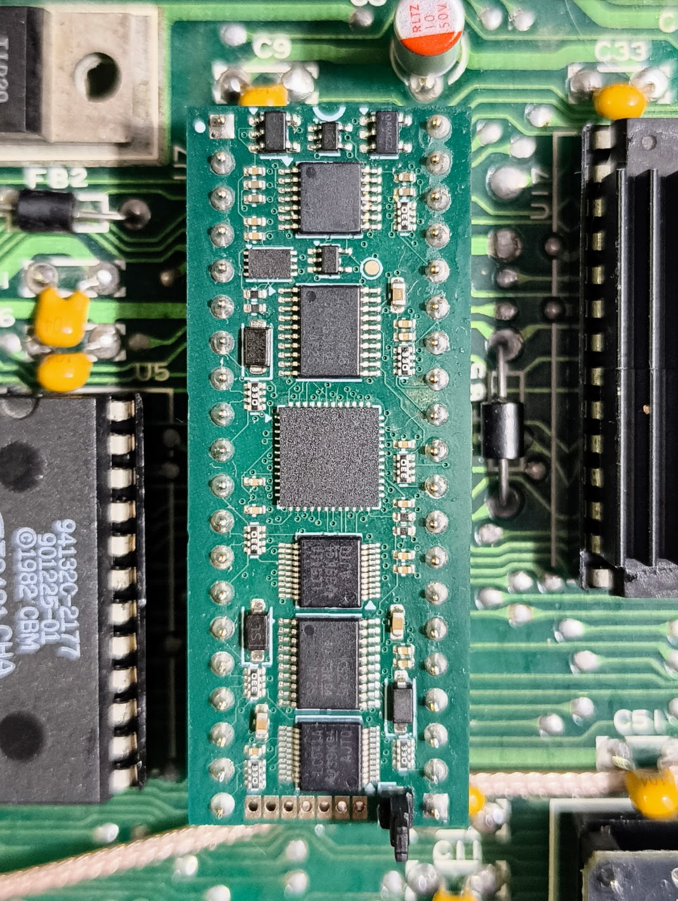

# MOSaic — an FPGA replacement for the C64's 6510 CPU

MOSaic is a small board that plugs into the Commodore 64's 6510 CPU socket and replaces the
CPU with a Lattice iCE40UP5K FPGA. The goal is a cycle-exact 6510, verified against the
real chip rather than against other emulations.

> **Free for non-commercial use.** MOSaic is a hobby project, given to the community.
> If it's useful to you, please consider [supporting it on Ko-fi](https://ko-fi.com/bitbarista).
> It funds the prototypes and test hardware.
> Want to sell boards? See [Commercial use](#commercial-use).
>
> **Ordering boards?** Signing up to JLCPCB through [this referral link](https://jlcpcb.com/?from=PBTJYEXOJNFQR) costs you nothing
> extra and earns the project a small credit towards new prototypes.

## Status (Rev A, October 2026)

On a real C64 with the current build (`$2ECB`):

- **VICE testprogs** (interrupts, CIA, VIC-II, CPU): all 169 pass, including the undocumented
  opcodes and the SHA/SHX/SHY/TAS behaviour during badlines.
  The 15 `ciavarious` CIA tests report on screen only, so they were checked by eye
  (`test-results/hardware/ciavarious_2ecb_20261019.log`). The full comparison is in
  `test-results/hardware/hw_2ecb_vs_e4e7_3e5d_20261014.txt`.
- **Demos:** a four-disk demo (NLP) runs all the way through, using a stock KERNAL and JiffyDOS.
- **[DRAMscope](https://github.com/bitbarista/dramscope)** (a C64 RAM tester that drives the
  memory bus through the CPU): 48 passes in an hour with no bad bytes.

In simulation:

- Klaus Dormann's functional test and the Lorenz test suite pass.
- Every bus cycle is compared with **perfect6502** (a transistor-level simulation of the
  real chip). This covers sweeps of interrupt timing against RDY stalls, the undocumented
  SH* opcodes, and double NMIs.

**Known limits.** These are listed openly; the details are in
[docs/KNOWN-ISSUES.md](docs/KNOWN-ISSUES.md).

- `interrupts/irqdma/test6b` gave one mismatch in 96 runs and could not be reproduced. The
  VICE testbench developers haven't seen this test misbehave before, though other tests in
  the testbench have needed fixing over the years. Run logs are in `test-results/hardware/`.
- The electrical checks against the 6510's AC and DC datasheet tables flag a few deviations,
  none seen to cause a fault. See `docs/KNOWN-ISSUES.md`.
- Tested in one C64 so far. The C64C (8500) has not been checked. It does **not** fit a 1541
  or a C128, whose CPUs have different pinouts.

## How it works

- **The CPU core** is T65, a VHDL 65xx core (FPGAARCADE 2015 release, BSD-3). Its upstream
  copyright and licence are kept, and the local fixes are listed in `NOTICE` and `patches/`.
- **The 6510 wrapper** — the I/O port, bus timing and RDY/AEC handling — is written from
  the 6510 datasheet: `rtl/cpu6510.v` and `rtl/top.v`.
- **Firmware updates** run on the C64 itself: a program writes a new image into a spare
  slot and checks it before switching. Power-on always boots slot A. See `updater/`.

## Building one

1. **Order the boards** from JLCPCB ([referral link](https://jlcpcb.com/?from=PBTJYEXOJNFQR)), fully assembled: `hardware/jlcpcb-reva/` holds the
   gerbers, BOM and placement file. `hardware/jlcpcb-reva/ORDERING.md` lists the options to choose.
2. **Fit the parts JLCPCB doesn't**: the 40 turned plug pins, soldered straight with the
   3D-printed jig, and the J4 update header. See **[docs/ASSEMBLY.md](docs/ASSEMBLY.md)**.
3. **Program it once**, then fit it in the C64. See
   **[docs/PROGRAMMING.md](docs/PROGRAMMING.md)**.

### Programming and updates

**[docs/PROGRAMMING.md](docs/PROGRAMMING.md)** is the step-by-step guide. It covers the
programmer and probe wiring, the first flash, fitting the board in the C64 and updating it
from the C64.

A new board is programmed **once**, on the bench, from a **Linux** PC, with an FT232H and a 1.27 mm pogo probe on
J3. Start `syn/pogo.sh --usb-last` first. It talks you through it hands-free: **seat the probe,
then plug the programmer's USB in last**.
After that, every update runs on the C64 itself, from `updater/out/MOSAIC.D64`.

### Building from source

- **Gateware:** run `syn/synth.sh`. This needs Yosys and nextpnr (OSS CAD Suite). From this
  source it reproduces `syn/build/mosaic.bin`, build ID `$2ECB`, md5
  `6a16527c77c44bc291d11e6a1fa41198`.
- **Test records:** the hardware run logs and the full simulation gate log are in
  `test-results/`, with a README saying what each one shows.

## Documents

| File | What |
|---|---|
| `docs/ASSEMBLY.md` | Parts to fit by hand (plug pins, J4), the soldering jig, order of work |
| `docs/PROGRAMMING.md` | First programming, fitting in the C64, updates |
| `docs/KNOWN-ISSUES.md` | Operating rules, datasheet deviations, what is not yet tested |
| `hardware/jlcpcb-reva/ORDERING.md` | JLCPCB order settings and parts |
| `test-results/README.md` | The raw test records: hardware runs and the simulation gate |
| `NOTICE` | Third-party code and its licences |

Comments in the source cite entries such as E-39, D-16 or S-19, and test scripts under `sim/`.
These are in the project's development tree, which is not published. The fixes they describe
are summarised in `NOTICE` and `patches/`, and the test results are in `test-results/`.

## Support the project

MOSaic took months of design work and several rounds of prototype boards. If you build one,
or it saved you hunting for a working 6510, a coffee on Ko-fi is very welcome:

New to JLCPCB? Signing up through [this referral link](https://jlcpcb.com/?from=PBTJYEXOJNFQR) also helps: it earns the project
a small credit towards new prototypes, at no cost to you.

## Commercial use

The licences below allow personal, non-commercial use: build one for yourself or a friend,
modify it, share your changes. **Selling boards, kits or pre-programmed parts needs a
commercial licence** — get in touch through [Ko-fi](https://ko-fi.com/bitbarista) or open a
GitHub issue titled "Commercial licence", and we can agree terms.

## Licence

© 2026 Carl Leach. Free for non-commercial use, under two licences:

- **Hardware design and documentation:** [CC BY-NC-SA 4.0](LICENSES/CC-BY-NC-SA-4.0.txt)
- **Gateware, firmware and tools:** [PolyForm Noncommercial 1.0.0](LICENSES/PolyForm-Noncommercial-1.0.0.md)

Third-party code keeps its own licence: the T65 core and the patches to it are BSD-3
(`rtl/t65/`, `patches/`). [LICENSE.md](LICENSE.md) says which licence covers which folder, and
`NOTICE` has the third-party notices.

*Not affiliated with, or endorsed by, any holder of the Commodore trademarks.*
