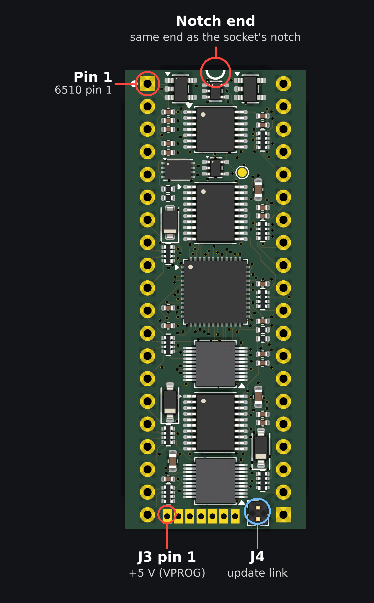

# Assembling MOSaic

JLCPCB builds the board with every surface-mount part fitted. **Three things are left for
you to fit by hand.** They are through-hole parts that are not in the BOM or the placement
file, by design.

| Ref | What | Qty per board | Notes |
|---|---|---|---|
| J1, J2 | 20-way 2.54 mm **turned-pin** (machined, round) single-row header | 2 | These plug into the C64's 6510 socket |
| J4 | 2-way **1.27 mm** pin header | 1 | The update link. Only needed to update the firmware |
| — | **1.27 mm** jumper (shunt) for J4 | 1 | Fitted only while updating |
| — | 3D-printed pin jig, `hardware/jig/pin_jig.stl` | 1 | Reusable, one is enough for any number of boards |

<!-- RELEASE TODO (Carl): supplier links for the turned-pin strips, the 1.27 mm header and jumper -->

The plug pins go in the two long rows of holes (J1 and J2). J4 is the 2-way header at the
bottom right, beside the J3 programming pads:

## The plug pins (J1, J2)

⚠ **Use turned (machined) round pins, not ordinary square-post headers.** A square 0.64 mm
post wedges into the dual-wipe contacts of the C64's CPU socket and splays them
permanently, which ruins the socket for the original 6510.

The prototypes use a 20-way 2.54 mm turned-pin SIL strip with gold-plated pins (Switch
Electronics 550951). Its pin is Ø0.60 mm above the plastic strip and Ø0.50 mm below it, the
end that goes into the socket. The board's holes are 0.90 mm. If you use a different strip,
check its drawing: the lower end should be about 0.5 mm round.

### The jig

The pins have to be straight and exactly on the socket's pitch, or the board won't go into
the socket. **Don't use the C64's own socket as a soldering fixture.** Use the jig.

- **Print** `hardware/jig/pin_jig.stl`. It has 40 guide holes, 1.20 mm across and 4 mm deep,
  on feet so the pin tips can poke through underneath. The source is
  `hardware/jig/pin_jig.scad`. Its hole positions were checked against the PCB file.
- **Check the fit before you solder.** Holes from different printers come out at different
  sizes. A pin should drop in without force and stand upright. If yours are too tight or too
  loose, change `hole_d` in the `.scad` and print it again.
- The jig is symmetric, so it works whichever way round it sits.

### Fitting

1. Put both strips in the jig, socket end **down**.
2. Lower the board onto them so the pins come up through J1 and J2 from the underside, and
   it sits flat on the strips.
3. Solder a corner pin on each strip, check that the board is still flat, then solder the
   rest.
4. Lift the board out of the jig.

The jig leaves room for J4, so it doesn't matter which you fit first. But read the next
section before fitting J4.

## The update link (J4)

J4 is a 2-way 1.27 mm header next to the J3 programming pads. With the jumper fitted, a
program on the C64 can write MOSaic's flash. Without it, nothing can. See
[PROGRAMMING.md](PROGRAMMING.md#3-updates-from-the-c64).

⚠ **Fit J4 after the board's first programming.** The header gets in the way of the pogo
probe on J3.

Keep the jumper **off** in normal use. While it is fitted, the C64 sees the datasette's PLAY
key as pressed.

## Order of work

1. Order the boards from JLCPCB (`hardware/jlcpcb-reva/`). New to JLCPCB? Signing up through
   [this referral link](https://jlcpcb.com/?from=PBTJYEXOJNFQR) supports the project at no cost to you.
2. Fit the plug pins with the jig.
3. **First programming**, on the bench ([PROGRAMMING.md](PROGRAMMING.md#1-first-programming)).
4. Fit the J4 header.
5. Fit MOSaic in the C64 ([PROGRAMMING.md](PROGRAMMING.md#2-fitting-it-in-the-c64)).
